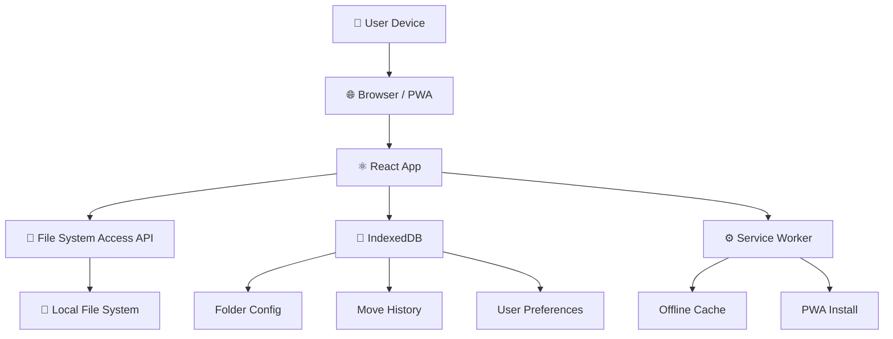
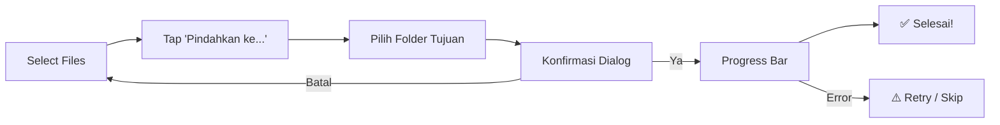
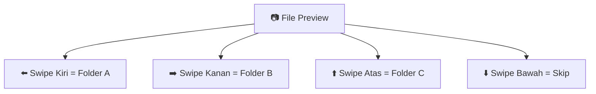
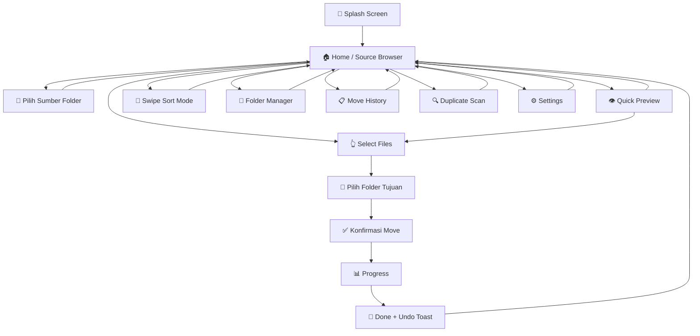
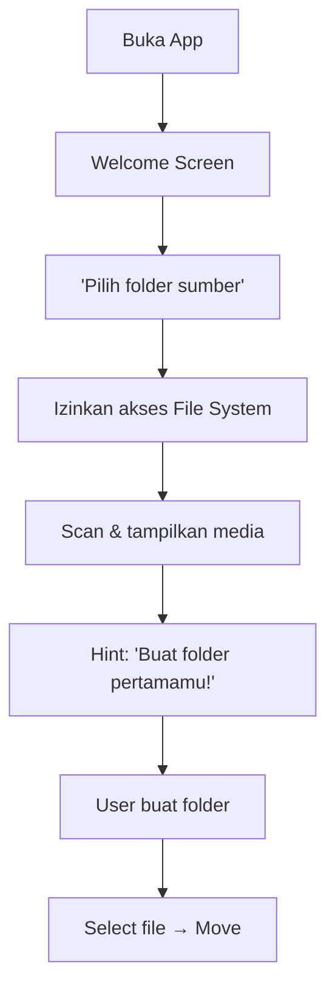
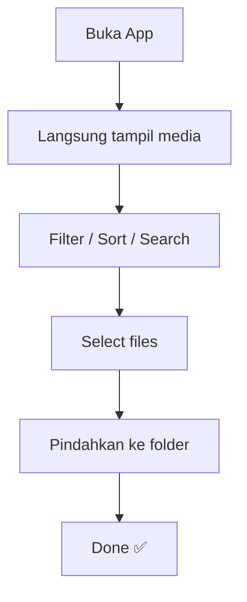
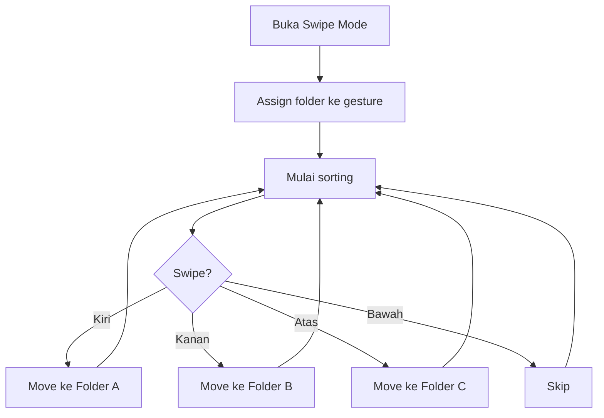

# 📋 Product Requirements Document (PRD)
# **Media Seleksi** — Aplikasi Pemisah Foto & Video

> **Versi:** 1.0
> **Tanggal:** 18 November 2026
> **Penulis:** Valerich
> **Status:** Draft

---

## 1. Ringkasan Eksekutif

**Media Seleksi** adalah web application (PWA) untuk mengorganisir file foto dan video dari perangkat pengguna ke dalam folder-folder custom. Aplikasi ini menyelesaikan masalah umum di mana album kamera menumpuk berbagai jenis media (foto kamera, screenshot, WhatsApp, dll) tanpa organisasi yang jelas.

Aplikasi dirancang untuk penggunaan **pribadi**, berjalan di **browser** (mobile & desktop), dan bisa di-**install** sebagai PWA di HP maupun laptop.

> [!IMPORTANT]
> Fokus utama: **Foto & Video** saja. Dokumen akan ditambahkan di fase berikutnya.

---

## 2. Latar Belakang & Masalah

### Masalah
- Album kamera di HP menumpuk ratusan/ribuan file tanpa organisasi
- Foto kamera, screenshot, foto WhatsApp, video, semuanya campur jadi satu
- Memisahkan secara manual lewat file manager sangat memakan waktu
- Tidak ada cara cepat untuk **preview → pilih → pindahkan** dalam satu alur

### Solusi
Aplikasi yang memberikan tampilan visual (thumbnail grid) dari semua media di perangkat, dengan kemampuan:
- Memilih file secara manual (multi-select)
- Memindahkan (move) ke folder-folder custom yang dibuat user
- Workflow yang cepat dan intuitif

---

## 3. Target Pengguna

| Aspek | Detail |
|---|---|
| **Tipe** | Penggunaan pribadi |
| **Perangkat** | Smartphone (Android/iOS) & Laptop/Desktop |
| **Profil** | User yang ingin merapikan galeri foto/video tanpa ribet |

---

## 4. Goals & Non-Goals

### ✅ Goals
- Satu aplikasi yang berjalan di mobile & desktop (PWA)
- Tampilan modern, minimalis, dan sederhana
- Workflow: Browse → Select → Move yang seamless
- Organisasi file ke folder custom buatan user
- Mendukung semua format foto & video umum

### ❌ Non-Goals
- Tidak ada fitur cloud sync / upload ke server
- Tidak ada fitur editing foto/video
- Tidak ada fitur sharing / social
- Tidak ada sistem login / akun
- Belum mendukung dokumen (fase berikutnya)

---

## 5. Format File yang Didukung

### 📷 Foto
| Format | Ekstensi |
|---|---|
| JPEG | `.jpg`, `.jpeg` |
| PNG | `.png` |
| WebP | `.webp` |
| HEIC/HEIF | `.heic`, `.heif` |
| GIF | `.gif` |
| BMP | `.bmp` |
| SVG | `.svg` |
| TIFF | `.tiff`, `.tif` |
| AVIF | `.avif` |

### 🎬 Video
| Format | Ekstensi |
|---|---|
| MP4 | `.mp4` |
| MOV | `.mov` |
| AVI | `.avi` |
| MKV | `.mkv` |
| WebM | `.webm` |
| 3GP | `.3gp` |
| FLV | `.flv` |
| WMV | `.wmv` |

---

## 6. Arsitektur Sistem

### Tech Stack

| Layer | Teknologi | Alasan |
|---|---|---|
| **Frontend** | React + TypeScript | Ekosistem mature, performa tinggi |
| **Styling** | Tailwind CSS | Utility-first, cepat untuk UI minimalis |
| **State Management** | Zustand | Ringan, simple, cocok untuk app kecil-menengah |
| **File Access** | File System Access API | Akses langsung ke filesystem lokal |
| **Fallback Mobile** | `<input type="file">` + drag & drop | Untuk browser yang belum support FS Access API |
| **Storage** | IndexedDB (Dexie.js) | Simpan metadata, history, folder config |
| **PWA** | Workbox / Vite PWA Plugin | Service worker, offline support, installable |
| **Build Tool** | Vite | Build cepat, HMR, optimized bundle |
| **Icons** | Lucide React | Icon set modern dan konsisten |

### Arsitektur Diagram



### Kompatibilitas Browser

| Browser | File System Access API | Fallback |
|---|---|---|
| Chrome / Edge (Desktop) | ✅ Full support | — |
| Chrome (Android) | ⚠️ Partial | Input file picker |
| Safari (iOS) | ❌ | Input file picker |
| Firefox | ❌ | Input file picker |

> [!NOTE]
> Pada browser yang tidak mendukung File System Access API, aplikasi akan menggunakan fallback `<input type="file">` untuk memilih file, dan menggunakan download untuk "memindahkan" file ke folder tujuan. User perlu menghapus file asli secara manual pada mode fallback.

---

## 7. Fitur Detail

### 7.1 — Source Browser (Halaman Utama)

Tampilan utama untuk melihat semua file foto & video dari sumber yang dipilih user.

**Spesifikasi:**
- Thumbnail grid layout (responsive: 2-4 kolom di mobile, 4-8 kolom di desktop)
- Toggle antara **Grid View** (thumbnail) dan **List View** (detail)
- Lazy loading untuk performa (hanya render thumbnail yang visible)
- Infinite scroll atau pagination
- Informasi file: nama, ukuran, tanggal, durasi (video), resolusi

**Filter & Sort:**
- Filter toggle: `Semua` | `Foto` | `Video`
- Sort by: `Tanggal (Terbaru)` | `Tanggal (Terlama)` | `Ukuran (Terbesar)` | `Ukuran (Terkecil)` | `Nama (A-Z)` | `Nama (Z-A)`
- Search bar: cari berdasarkan nama file

### 7.2 — Multi-Select System

Sistem pemilihan file yang fleksibel.

**Spesifikasi:**
- Tap/klik file untuk toggle select (ada checkmark overlay)
- **Select All** button — pilih semua file yang visible (sesuai filter aktif)
- **Deselect All** button — batalkan semua pilihan
- **Selection counter** — "23 file dipilih (12 foto, 11 video — 1.2 GB)"
- Long-press (mobile) atau right-click (desktop) untuk context menu
- Drag select / rubber band select (desktop only)

### 7.3 — Folder Management

Sistem folder custom yang sepenuhnya dikontrol user.

**Spesifikasi:**
- **Create folder** — buat folder baru dengan nama custom
- **Rename folder** — ubah nama folder
- **Delete folder** — hapus folder (dengan konfirmasi, pindahkan isi ke "Unfiled")
- **Reorder folders** — drag & drop untuk atur urutan tampilan
- **Folder color/icon** — pilih warna atau emoji untuk tiap folder
- **Badge counter** — tampilkan jumlah file di tiap folder
- **Storage info** — tampilkan total ukuran file per folder

**Default State:**
- Tidak ada folder bawaan — user membuat sendiri sesuai kebutuhan
- Tombol "+" yang prominent untuk membuat folder pertama
- Onboarding hint: "Buat folder pertamamu untuk mulai mengorganisir!"

### 7.4 — Move System

Mekanisme pemindahan file dari sumber ke folder tujuan.

**Spesifikasi:**
- Setelah select file → tap tombol **"Pindahkan ke..."**
- Muncul bottom sheet (mobile) / modal (desktop) dengan daftar folder tujuan
- **Konfirmasi dialog:** "Pindahkan 23 file ke folder 'Kerjaan'?"
- **Progress bar** dengan detail: "Memindahkan 15/23 file... (video_001.mp4)"
- Handle error gracefully (file locked, permission denied, storage full)
- Operasi berjalan di background (user bisa tetap browse)

**Flow Diagram:**



### 7.5 — Quick Preview

Preview file dalam ukuran penuh sebelum memutuskan.

**Spesifikasi:**
- Tap thumbnail → buka full-screen preview
- Swipe kiri/kanan untuk navigasi antar file
- Pinch to zoom (mobile)
- Tampilkan metadata: nama, ukuran, tanggal, resolusi/durasi
- Tombol **"Pindahkan"** langsung dari preview
- Tombol **Select** untuk menambah ke seleksi tanpa keluar preview
- Video: inline player dengan play/pause

### 7.6 — Swipe-to-Sort (Mobile)

Mode sorting cepat ala Tinder — khusus mobile.

**Spesifikasi:**
- Masuk ke "Sort Mode" dari menu
- Tampilkan satu file besar di tengah layar
- Swipe ke kiri/kanan/atas → masing-masing menuju folder berbeda
- User bisa assign gesture ke folder tertentu (max 4 arah: kiri, kanan, atas, bawah)
- Swipe indicator dengan nama folder tujuan
- Skip button untuk lewati file
- Counter: "32/150 file sudah disortir"



### 7.7 — Auto-Detect Label

Deteksi otomatis tipe/sumber media dan berikan label.

**Spesifikasi:**
- Deteksi berdasarkan **path/nama file** dan **metadata EXIF**:
  - 📸 `Kamera` — file dari DCIM/Camera
  - 📱 `Screenshot` — mengandung "screenshot" di nama/path
  - 💬 `WhatsApp` — dari folder WhatsApp
  - 📲 `Telegram` — dari folder Telegram
  - ⬇️ `Download` — dari folder Download
  - 🖼️ `Edited` — file yang sudah diedit (metadata hint)
- Label ditampilkan sebagai **badge/tag** kecil di thumbnail
- Bisa digunakan sebagai filter tambahan

### 7.8 — Duplicate Detector

Identifikasi file yang kemungkinan duplikat.

**Spesifikasi:**
- Scan berdasarkan: nama file identik, ukuran file identik, atau hash comparison
- Tampilkan grup duplikat berdampingan
- Quick action: "Simpan 1, hapus sisanya"
- Badge indicator di thumbnail untuk file yang terdeteksi duplikat
- Mode scan terpisah (tidak auto-run, user trigger manual)

### 7.9 — Undo / Move History

Riwayat perpindahan file dan kemampuan undo.

**Spesifikasi:**
- **Toast notification** setelah move: "23 file dipindahkan ke 'Kerjaan' — UNDO"
- Tombol **Undo** dalam 10 detik setelah move
- **History page** — log semua operasi move:
  - Tanggal & waktu
  - Jumlah file
  - Dari mana → ke mana
  - Tombol "Reverse" untuk kembalikan
- History disimpan di IndexedDB
- Batas history: 100 operasi terakhir

### 7.10 — Storage Info

Informasi penggunaan storage.

**Spesifikasi:**
- **Dashboard kecil** di halaman utama:
  - Total file: xxx foto, xxx video
  - Total ukuran: xx GB
  - Sisa storage device (jika API tersedia)
- **Per-folder stats:**
  - Jumlah file
  - Total ukuran
  - Breakdown foto vs video

---

## 8. Desain UI/UX

### Design Principles

| Prinsip | Implementasi |
|---|---|
| **Modern** | Rounded corners, subtle shadows, smooth animations |
| **Minimalis** | Warna netral, whitespace cukup, tanpa elemen berlebih |
| **Sederhana** | Maksimal 2 tap untuk aksi utama, UI self-explanatory |
| **Responsif** | Adaptif dari 320px (mobile) sampai 1920px (desktop) |

### Color Palette

```
Primary      : #6366F1  (Indigo-500)
Primary Dark : #4F46E5  (Indigo-600)
Surface      : #FFFFFF
Background   : #F8FAFC  (Slate-50)
Card         : #FFFFFF
Border       : #E2E8F0  (Slate-200)
Text Primary : #0F172A  (Slate-900)
Text Secondary: #64748B (Slate-500)
Success      : #22C55E  (Green-500)
Warning      : #F59E0B  (Amber-500)
Danger       : #EF4444  (Red-500)
```

### Dark Mode

```
Surface      : #0F172A  (Slate-900)
Background   : #020617  (Slate-950)
Card         : #1E293B  (Slate-800)
Border       : #334155  (Slate-700)
Text Primary : #F1F5F9  (Slate-100)
Text Secondary: #94A3B8 (Slate-400)
```

### Typography

| Element | Font | Size | Weight |
|---|---|---|---|
| Heading 1 | Inter | 24px | Bold (700) |
| Heading 2 | Inter | 20px | Semibold (600) |
| Body | Inter | 14px | Regular (400) |
| Caption | Inter | 12px | Regular (400) |
| Button | Inter | 14px | Medium (500) |

### Layout — Mobile

```
┌─────────────────────────┐
│  ☰  Media Seleksi  🔍  │  ← Header (fixed)
├─────────────────────────┤
│ [Semua] [Foto] [Video]  │  ← Filter tabs
├─────────────────────────┤
│ ┌─────┐ ┌─────┐ ┌─────┐│
│ │ 📷  │ │ 🎬  │ │ 📷  ││
│ │     │ │     │ │     ││  ← Thumbnail Grid
│ │  ☑  │ │     │ │  ☑  ││    (3 kolom)
│ └─────┘ └─────┘ └─────┘│
│ ┌─────┐ ┌─────┐ ┌─────┐│
│ │ 📷  │ │ 📷  │ │ 🎬  ││
│ │     │ │     │ │     ││
│ │     │ │     │ │     ││
│ └─────┘ └─────┘ └─────┘│
│          ...             │
├─────────────────────────┤
│ ✅ 5 dipilih (2.3 MB)   │  ← Selection bar (muncul
│ [Pindahkan ke...]       │    saat ada file terpilih)
├─────────────────────────┤
│  🏠    📁    🔄    ⚙️   │  ← Bottom nav
│ Beranda Folder History Setting│
└─────────────────────────┘
```

### Layout — Desktop

```
┌──────────────────────────────────────────────────────┐
│  🗂️ Media Seleksi    [🔍 Search...]    ☀️/🌙  ⚙️   │  ← Top bar
├────────────┬─────────────────────────────────────────┤
│            │ [Semua] [Foto] [Video]   Sort: Terbaru ▼│
│  📁 Folders│─────────────────────────────────────────│
│            │ ┌────┐ ┌────┐ ┌────┐ ┌────┐ ┌────┐    │
│  + Buat    │ │ 📷 │ │ 🎬 │ │ 📷 │ │ 📷 │ │ 🎬 │    │
│            │ │  ☑ │ │    │ │  ☑ │ │    │ │    │    │
│  ─────     │ └────┘ └────┘ └────┘ └────┘ └────┘    │
│  Kerjaan 12│ ┌────┐ ┌────┐ ┌────┐ ┌────┐ ┌────┐    │
│  Pribadi  8│ │ 📷 │ │ 📷 │ │ 🎬 │ │ 📷 │ │ 📷 │    │
│  Meme    23│ │    │ │    │ │    │ │    │ │    │    │
│  Penting  3│ └────┘ └────┘ └────┘ └────┘ └────┘    │
│            │                                         │
│  ─────     │              ...                        │
│  💾 12 GB  │                                         │
│  📊 Stats  ├─────────────────────────────────────────│
│  📋 History│ ✅ 5 file dipilih (2.3 MB)  [Pindahkan]│
└────────────┴─────────────────────────────────────────┘
```

### PWA App Icon

**Konsep:** Dua folder yang saling overlap dengan panah pemisah, dalam style flat/modern.

**Spesifikasi Icon:**
| Ukuran | Penggunaan |
|---|---|
| 192×192 px | Android home screen |
| 512×512 px | Android splash screen |
| 180×180 px | iOS home screen |
| 32×32 px | Favicon |
| 16×16 px | Favicon small |

**Desain:**
- Background: Gradient `#6366F1` → `#8B5CF6` (Indigo to Violet)
- Foreground: Icon putih — dua folder dengan panah sorting
- Border radius: Mengikuti platform (Android adaptive icon / iOS rounded)
- Maskable area: Safe zone 80% untuk Android adaptive icons

---

## 9. Screen Flow



---

## 10. Halaman & Komponen

### 10.1 Daftar Halaman

| # | Halaman | Deskripsi |
|---|---|---|
| 1 | **Home / Browser** | Grid thumbnail semua media + filter + sort + search |
| 2 | **Preview** | Full-screen preview foto/video dengan navigasi |
| 3 | **Folder Manager** | CRUD folder tujuan + stats |
| 4 | **Swipe Sort** | Mode sorting cepat (mobile-first) |
| 5 | **Duplicate Scanner** | Scan & manage file duplikat |
| 6 | **Move History** | Log riwayat semua operasi move |
| 7 | **Settings** | Theme, view preference, storage info |

### 10.2 Komponen Reusable

| Komponen | Dipakai Di |
|---|---|
| `ThumbnailCard` | Home, Preview, Duplicate |
| `FolderChip` | Folder Manager, Move Dialog |
| `SelectionBar` | Home (muncul saat select) |
| `MoveDialog` | Home, Preview |
| `ProgressOverlay` | Global |
| `FilterTabs` | Home |
| `SortDropdown` | Home |
| `SearchBar` | Home |
| `UndoToast` | Global |
| `ConfirmDialog` | Global |
| `EmptyState` | Home, Folder, History |

---

## 11. Data Model

### IndexedDB Schema

```typescript
// Folder yang dibuat user
interface Folder {
  id: string;              // UUID
  name: string;            // "Kerjaan"
  color: string;           // "#6366F1"
  emoji: string;           // "💼"
  order: number;           // Urutan tampilan
  createdAt: Date;
  updatedAt: Date;
}

// Record file yang sudah dipindahkan
interface FileRecord {
  id: string;              // UUID
  fileName: string;        // "IMG_20261118.jpg"
  fileSize: number;        // bytes
  fileType: 'photo' | 'video';
  mimeType: string;        // "image/jpeg"
  folderId: string;        // FK ke Folder
  originalPath: string;    // Path asli sebelum dipindah
  currentPath: string;     // Path setelah dipindah
  movedAt: Date;
  label?: string;          // "screenshot" | "whatsapp" | "camera" | ...
}

// History operasi move
interface MoveOperation {
  id: string;              // UUID
  fileCount: number;
  totalSize: number;       // bytes
  targetFolderId: string;  // FK ke Folder
  targetFolderName: string;
  files: MoveFileEntry[];  // Detail per file
  timestamp: Date;
  reversed: boolean;       // Sudah di-undo?
}

interface MoveFileEntry {
  fileName: string;
  fromPath: string;
  toPath: string;
}

// User preferences
interface UserPreferences {
  theme: 'light' | 'dark' | 'system';
  viewMode: 'grid' | 'list';
  gridColumns: number;     // 2-8
  sortBy: 'date' | 'size' | 'name';
  sortOrder: 'asc' | 'desc';
  defaultFilter: 'all' | 'photo' | 'video';
}
```

---

## 12. PWA Configuration

### manifest.json

```json
{
  "name": "Media Seleksi",
  "short_name": "Seleksi",
  "description": "Organisir foto & video ke folder custom",
  "start_url": "/",
  "display": "standalone",
  "orientation": "portrait",
  "background_color": "#F8FAFC",
  "theme_color": "#6366F1",
  "categories": ["utilities", "productivity"],
  "icons": [
    {
      "src": "/icons/icon-192.png",
      "sizes": "192x192",
      "type": "image/png",
      "purpose": "any"
    },
    {
      "src": "/icons/icon-512.png",
      "sizes": "512x512",
      "type": "image/png",
      "purpose": "any"
    },
    {
      "src": "/icons/icon-maskable-192.png",
      "sizes": "192x192",
      "type": "image/png",
      "purpose": "maskable"
    },
    {
      "src": "/icons/icon-maskable-512.png",
      "sizes": "512x512",
      "type": "image/png",
      "purpose": "maskable"
    }
  ]
}
```

---

## 13. Performance Requirements

| Metrik | Target |
|---|---|
| **First Contentful Paint** | < 1.5 detik |
| **Largest Contentful Paint** | < 2.5 detik |
| **Time to Interactive** | < 3 detik |
| **Thumbnail load** | < 200ms per batch (20 thumbnails) |
| **Move operation** | Progress update real-time |
| **Max file scan** | Handle 10,000+ file tanpa freeze |
| **Bundle size** | < 500 KB (gzipped) |
| **Lighthouse PWA score** | > 90 |

---

## 14. User Flow Detail

### Flow 1: First Time User



### Flow 2: Regular Use



### Flow 3: Swipe Sort



---

## 15. Project Structure

```
media-seleksi/
├── public/
│   ├── icons/                    # PWA icons
│   │   ├── icon-16.png
│   │   ├── icon-32.png
│   │   ├── icon-180.png
│   │   ├── icon-192.png
│   │   ├── icon-512.png
│   │   ├── icon-maskable-192.png
│   │   └── icon-maskable-512.png
│   ├── favicon.ico
│   └── manifest.json
├── src/
│   ├── components/
│   │   ├── common/               # Button, Dialog, Toast, etc.
│   │   ├── browser/              # ThumbnailGrid, FilterTabs, SearchBar
│   │   ├── folder/               # FolderList, FolderCard, CreateFolder
│   │   ├── preview/              # ImagePreview, VideoPlayer
│   │   ├── move/                 # MoveDialog, ProgressBar, UndoToast
│   │   ├── swipe/                # SwipeCard, GestureAssign
│   │   ├── duplicate/            # DuplicateGroup, DuplicateScanner
│   │   └── layout/               # Header, BottomNav, Sidebar
│   ├── pages/
│   │   ├── HomePage.tsx
│   │   ├── FolderPage.tsx
│   │   ├── PreviewPage.tsx
│   │   ├── SwipeSortPage.tsx
│   │   ├── DuplicatePage.tsx
│   │   ├── HistoryPage.tsx
│   │   └── SettingsPage.tsx
│   ├── hooks/
│   │   ├── useFileSystem.ts      # File System Access API wrapper
│   │   ├── useMediaScanner.ts    # Scan & categorize media
│   │   ├── useFileMover.ts       # Move operations
│   │   ├── useDuplicates.ts      # Duplicate detection
│   │   └── useSwipeGesture.ts    # Swipe gesture handler
│   ├── stores/
│   │   ├── folderStore.ts        # Zustand store untuk folders
│   │   ├── selectionStore.ts     # Selected files state
│   │   ├── historyStore.ts       # Move history
│   │   └── preferenceStore.ts    # User preferences
│   ├── services/
│   │   ├── fileService.ts        # File operations abstraction
│   │   ├── thumbnailService.ts   # Thumbnail generation
│   │   ├── labelDetector.ts      # Auto-detect source labels
│   │   └── db.ts                 # IndexedDB via Dexie.js
│   ├── utils/
│   │   ├── fileTypes.ts          # Format detection & constants
│   │   ├── formatters.ts         # Size, date formatters
│   │   └── constants.ts
│   ├── types/
│   │   └── index.ts              # TypeScript interfaces
│   ├── App.tsx
│   ├── main.tsx
│   └── index.css                 # Tailwind imports
├── index.html
├── tailwind.config.ts
├── tsconfig.json
├── vite.config.ts
├── package.json
└── README.md
```

---

## 16. Development Phases

### Phase 1 — MVP Core (Week 1-2)
- [x] Project setup (Vite + React + TypeScript + Tailwind)
- [ ] PWA configuration + app icon
- [ ] File System Access API integration
- [ ] Thumbnail grid view (responsive)
- [ ] Basic multi-select
- [ ] Folder CRUD (create, rename, delete)
- [ ] Move files to folder
- [ ] Konfirmasi dialog + progress bar

### Phase 2 — Enhanced UX (Week 3)
- [ ] Filter (Foto/Video) + Sort options
- [ ] Search by filename
- [ ] Quick preview (full-screen)
- [ ] Grid/List view toggle
- [ ] Select All / Deselect All
- [ ] Dark mode
- [ ] Undo toast + Move history

### Phase 3 — Advanced Features (Week 4)
- [ ] Swipe-to-sort mode (mobile)
- [ ] Auto-detect labels (Screenshot, WhatsApp, dll)
- [ ] Duplicate detector
- [ ] Storage info dashboard
- [ ] Folder color/emoji customization
- [ ] Badge counter per folder
- [ ] Fallback mode untuk browser tanpa FS API

### Phase 4 — Polish & Optimize (Week 5)
- [ ] Performance optimization (virtual scroll, web workers)
- [ ] Animasi & transisi halus
- [ ] Error handling & edge cases
- [ ] Onboarding / first-time user experience
- [ ] Accessibility (keyboard nav, screen reader)
- [ ] Testing & bug fixes

> [!TIP]
> **Fase selanjutnya (Future):** Tambahkan dukungan file dokumen (PDF, DOCX, XLSX, dll) sebagai kategori ketiga.

---

## 17. Risiko & Mitigasi

| Risiko | Dampak | Mitigasi |
|---|---|---|
| **File System Access API** tidak didukung di semua browser | File move tidak bisa dilakukan natively | Fallback ke input file + download |
| **File besar** (video 4K) bikin app lambat | UX buruk, app freeze | Web Workers untuk operasi berat, virtual scroll |
| **Permission** ditolak user | App tidak bisa akses file | Clear onboarding, jelaskan kenapa butuh akses |
| **Data loss** saat move gagal di tengah jalan | File hilang | Atomic move: verify dulu, baru hapus source |
| **Storage penuh** | Move gagal | Cek storage sebelum mulai, beri warning |

---

## 18. Success Metrics

| Metrik | Target |
|---|---|
| Waktu untuk sort 100 file | < 10 menit (manual), < 3 menit (swipe mode) |
| Move operation success rate | > 99% |
| App load time | < 3 detik |
| Crash rate | 0% |
| User satisfaction | App terasa lebih cepat dari file manager bawaan |

---

## 19. Glossary

| Term | Definisi |
|---|---|
| **PWA** | Progressive Web App — web app yang bisa di-install dan jalan offline |
| **File System Access API** | Browser API untuk akses langsung ke file system lokal |
| **IndexedDB** | Database lokal di browser untuk menyimpan data terstruktur |
| **Thumbnail** | Gambar preview ukuran kecil dari file asli |
| **Move** | Memindahkan file dari lokasi asal ke folder tujuan (cut & paste) |
| **Fallback** | Mekanisme alternatif saat fitur utama tidak tersedia |

---

> [!IMPORTANT]
> **Dokumen ini adalah living document.** Update sesuai perkembangan development dan feedback.

---

*Last updated: 18 November 2026*

